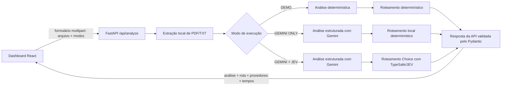

# AI Decision Lab — Análise de Documentos e Roteamento Inteligente

> Uma aplicação demonstrativa de AI Engineering para portfólio, com foco em análise estruturada de documentos, roteamento explicável de decisões e medição transparente da latência de cada provedor.

O **AI Decision Lab** é um projeto pessoal e independente que demonstra como combinar extração local de texto, saída estruturada de LLMs e roteamento de decisões com tipos seguros em uma aplicação web completa.

O projeto utiliza documentos inteiramente sintéticos e recomendações demonstrativas. Ele não realiza aprovação jurídica, regulatória ou de conformidade automática. Este projeto não possui associação, patrocínio ou vínculo com a GFT ou com qualquer projeto de cliente.

## Visão geral

A aplicação recebe arquivos PDF ou TXT fictícios, extrai o texto localmente e executa um pipeline configurável de análise e roteamento. O dashboard permite comparar três modos de execução, identificar os provedores realmente utilizados e visualizar a duração total e por etapa.

O modo DEMO funciona sem credenciais e produz resultados determinísticos. Quando habilitadas, as integrações reais utilizam o **Google Gemini 2.5 Flash** para análise estruturada e o **JEV / TypeSafe** para classificação e roteamento por meio do SDK oficial.

## Principais funcionalidades

- Upload de documentos sintéticos em PDF ou TXT, com limite configurável de tamanho.
- Extração local de texto com validação de tipo, extensão, conteúdo e tamanho do arquivo.
- Análise estruturada com resumo, tipo de documento, itens de atenção e indicadores objetivos.
- Modo DEMO determinístico, disponível sem chaves de API.
- Integração real com Google Gemini 2.5 Flash usando resposta estruturada validada pelo Pydantic.
- Roteamento com interface abstrata `DecisionProvider` e implementações locais e JEV / TypeSafe.
- Três recomendações demonstrativas: `APPROVE_FOR_REVIEW`, `NEEDS_HUMAN_REVIEW` e `INSUFFICIENT_INFORMATION`.
- Comparação entre GEMINI ONLY e GEMINI + JEV, com duração total e por etapa.
- Identificação explícita dos provedores solicitados e efetivamente utilizados, sem fallback silencioso.
- Histórico local da sessão no navegador.
- Tratamento seguro de exceções, timeouts e ausência de credenciais.
- Testes automatizados com mocks, sem chamadas pagas.
- Interface responsiva em dark mode, com paleta original em navy, ciano e violeta.

## Stack tecnológica

| Camada | Tecnologias |
| --- | --- |
| Backend | Python 3.12+, FastAPI, Pydantic, PyMuPDF, pytest |
| Frontend | React, TypeScript, Vite |
| IA generativa | SDK oficial Google GenAI, Gemini 2.5 Flash |
| Roteamento | SDK oficial TypeSafe/JEV, modelo `jev-latest` |
| Persistência | Histórico local da sessão no navegador; sem banco de dados |
| Infraestrutura | Execução local; sem Docker na primeira versão |

Os detalhes da validação das integrações estão documentados em [docs/validation-results.md](docs/validation-results.md).

## Arquitetura



O backend está organizado em rotas, schemas, serviços e integrações. A extração de documentos é local; o conteúdo completo do arquivo e os prompts não são registrados em logs. O frontend consome uma única rota de análise e apresenta o estado de execução sem expor credenciais.

## Modos de execução

| Modo exibido | Análise | Roteamento | Credenciais necessárias |
| --- | --- | --- | --- |
| DEMO | `DemoAnalyzer` determinístico | `DemoDecisionProvider` determinístico | Nenhuma |
| GEMINI ONLY | `GeminiAnalyzer` real | Roteamento local determinístico | `GEMINI_API_KEY` |
| GEMINI + JEV | `GeminiAnalyzer` real | `JevDecisionProvider` real | `GEMINI_API_KEY` e `JEV_API_KEY` |

O frontend envia explicitamente `analysis_mode` e `decision_mode` em cada requisição. O backend não substitui uma integração real por DEMO de forma silenciosa: falhas de configuração, autenticação, timeout, resposta inválida ou indisponibilidade do provedor são retornadas como erros sanitizados e identificáveis.

Todas as rotas são recomendações demonstrativas para triagem. `APPROVE_FOR_REVIEW` significa apenas que o documento pode seguir para uma etapa de revisão; nunca representa aprovação jurídica ou regulatória automática.

## Resultados da integração real

Uma execução real, feita exclusivamente com um documento sintético, validou o pipeline **Gemini 2.5 Flash + JEV / TypeSafe** de ponta a ponta.

| Etapa | Resultado observado |
| --- | --- |
| Extração local | 9,0 ms |
| Análise Gemini | 11.738,2 ms |
| Roteamento JEV | 606,1 ms |
| Duração total | 12.355,8 ms |
| Decisão | Revisão humana necessária (`NEEDS_HUMAN_REVIEW`) |
| Confiança exibida | 86% |
| Completude | 20/100 |

Esses valores correspondem a **uma única execução observada**, e não a um benchmark. Eles não sustentam alegações de redução de latência ou superioridade entre os modos. Uma comparação reproduzível exige múltiplas execuções controladas, mesmas entradas, modelos equivalentes, condições de cache documentadas e análise estatística.

## Capturas de tela

As capturas de tela do dashboard serão adicionadas antes da publicação final. Os locais e a convenção sugerida estão descritos em [docs/screenshots/README.md](docs/screenshots/README.md).

## Primeiros passos

### Pré-requisitos

- Python 3.12 ou superior.
- Node.js 20 ou superior e npm.
- Uma chave do Google Gemini apenas para os modos reais de análise.
- Uma chave do JEV / TypeSafe apenas para o modo real de roteamento.

O modo DEMO não exige credenciais e deve ser usado para a primeira execução local.

### Backend — Windows PowerShell

```powershell
cd "C:\Projetos\AI Decision Lab\apps\backend"
python -m venv .venv
.\.venv\Scripts\Activate.ps1
python -m pip install -e ".[dev]"
python -m uvicorn app.main:app --reload --port 8000
```

O backend ficará disponível em `http://localhost:8000`. A documentação interativa da API pode ser acessada em `http://localhost:8000/docs`.

### Frontend — Windows PowerShell

Em outro terminal:

```powershell
cd "C:\Projetos\AI Decision Lab\apps\frontend"
npm install
npm run dev
```

Abra `http://localhost:5173` no navegador.

## Variáveis de ambiente

Copie `.env.example` para `.env` na raiz do projeto e preencha somente as integrações que deseja ativar. Nunca inclua chaves reais em commits.

```dotenv
APP_ENV=development
MAX_UPLOAD_MB=8
REQUEST_TIMEOUT_SECONDS=30
ALLOWED_ORIGINS=http://localhost:5173

GEMINI_ENABLED=false
GEMINI_API_KEY=replace-with-your-gemini-key
GEMINI_MODEL=gemini-2.5-flash

JEV_ENABLED=false
JEV_API_KEY=replace-with-your-typesafe-key
JEV_MODEL=jev-latest

VITE_API_BASE_URL=http://localhost:8000
```

Defina `GEMINI_ENABLED=true` para habilitar GEMINI ONLY. Para GEMINI + JEV, defina também `JEV_ENABLED=true`. As chaves permanecem exclusivamente no backend e nunca são enviadas ao navegador.

## Executando os testes

Os testes automatizados utilizam mocks para as integrações externas. Eles não devem fazer chamadas reais ao Gemini ou ao JEV / TypeSafe.

### Backend

```powershell
cd "C:\Projetos\AI Decision Lab\apps\backend"
.\.venv\Scripts\Activate.ps1
python -m pytest
```

### Frontend

```powershell
cd "C:\Projetos\AI Decision Lab\apps\frontend"
npm run typecheck
npm run build
```

A validação automatizada registrada no projeto informa **19 testes Python aprovados**, além do typecheck e do build do frontend concluídos com sucesso. Esses resultados são mantidos do registro existente; os testes não foram reexecutados durante esta tradução do README.

## Limitações

- A aplicação é demonstrativa e utiliza somente documentos fictícios.
- As recomendações não substituem análise humana, jurídica, regulatória ou de conformidade.
- A primeira versão não possui autenticação, banco de dados, fila de tarefas ou armazenamento permanente.
- O histórico existe apenas na sessão local do navegador.
- PDFs digitalizados sem camada de texto exigiriam OCR, que não está incluído nesta versão.
- A disponibilidade, os custos, os limites e a latência dos provedores externos podem variar.
- A confiança exibida é um indicador do provedor para fins demonstrativos, não uma probabilidade calibrada de correção.
- Os resultados de uma única execução real não constituem benchmark nem comprovam ganho de desempenho.

## Melhorias futuras

- Adicionar OCR opcional para PDFs digitalizados.
- Criar uma suíte de avaliação com conjunto de dados sintético versionado e métricas reproduzíveis.
- Executar benchmarks controlados com aquecimento, repetições, percentis e registro das condições de cache.
- Adicionar autenticação e controle de acesso para cenários multiusuário.
- Incluir persistência opcional de histórico com políticas explícitas de retenção.
- Adicionar observabilidade com métricas agregadas e rastreamento seguro, sem conteúdo de documentos.
- Ampliar a cobertura de testes do frontend e adicionar testes end-to-end locais.
- Publicar capturas de tela e uma demonstração em vídeo com dados inteiramente sintéticos.

## Autor

Projeto pessoal de **Gabriel Cipolla**, desenvolvido como demonstração pública de competências em AI Engineering, Python, FastAPI, React, integração de modelos e desenho de sistemas seguros.

- GitHub: [github.com/gcipolla1402](https://github.com/gcipolla1402)
- LinkedIn: [linkedin.com/in/gabriel-cipolla-a75605221](https://www.linkedin.com/in/gabriel-cipolla-a75605221/)

Antes da publicação, consulte a [lista de verificação de publicação](docs/publication-checklist.md).
