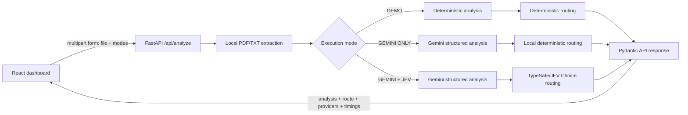

# AI Decision Lab — Document Analysis & Intelligent Routing

> A portfolio-grade AI engineering application for structured document analysis, explainable routing, and transparent provider-level latency measurement.

AI Decision Lab is a personal demonstration project that processes synthetic PDF or TXT documents, extracts their text locally, generates a structured analysis, and recommends a review route. It supports deterministic offline execution as well as real Google Gemini and TypeSafe/JEV integrations, while making the active providers and execution timings visible in the interface.

The routes are workflow recommendations only. They are not legal, regulatory, compliance, or automatic approval decisions.

## Overview

Document-processing systems often combine extraction, generative analysis, and deterministic or model-assisted routing. Without explicit execution modes and provider telemetry, it can be difficult to tell which component produced a result or where time was spent.

This project makes that pipeline observable. The FastAPI backend validates uploads, extracts text in memory, invokes the selected analysis and routing providers, validates structured responses with Pydantic, and returns stage timings and provider metadata to a React dashboard.

## Key Features

- PDF and UTF-8 TXT uploads with configurable size limits
- Local text extraction with file type, size, content, and PDF page-count validation
- Structured document analysis: summary, type, attention items, objective indicators, and completeness score
- Three explicit execution modes: DEMO, GEMINI ONLY, and GEMINI + JEV
- Deterministic DEMO mode with no API credentials or external calls
- Google Gemini structured output through the official `google-genai` SDK
- TypeSafe/JEV typed routing through the official `typesafe-sdk`
- Review routes: `APPROVE_FOR_REVIEW`, `NEEDS_HUMAN_REVIEW`, and `INSUFFICIENT_INFORMATION`
- Provider- and stage-specific error handling without silent DEMO fallback
- Per-stage timing for extraction, analysis, routing, and total execution
- Responsive dark-mode dashboard with session-local history
- Mocked automated tests that do not call paid APIs

## Tech Stack

| Area | Technologies |
| --- | --- |
| Backend | Python 3.12+, FastAPI, Pydantic, PyMuPDF, Uvicorn |
| Frontend | React, TypeScript, Vite, Lucide React |
| AI providers | Google Gemini via `google-genai`; TypeSafe/JEV via `typesafe-sdk` |
| Testing | pytest, FastAPI TestClient, provider mocks, TypeScript compiler, Vite build |
| Configuration | `python-dotenv`, server-side environment variables |

Versions observed during the latest local validation are recorded in [docs/validation-results.md](docs/validation-results.md).

## Architecture



Backend responsibilities are separated across API routes, schemas, extraction, analysis providers, decision providers, and pipeline orchestration. Documents are processed in memory; this version does not include a database or server-side upload persistence.

## Execution Modes

| Mode | Analysis | Routing | External API use |
| --- | --- | --- | --- |
| **DEMO** | Local deterministic rules | Local deterministic rules | None |
| **GEMINI ONLY** | Google Gemini | Local deterministic rules | Gemini |
| **GEMINI + JEV** | Google Gemini | TypeSafe/JEV typed `Choice` | Gemini and JEV |

The backend requires the requested mode fields and reports the providers actually used. Provider failures return explicit errors; the application does not silently replace a failed live provider with DEMO output.

## Real Integration Results

One real execution was observed through the frontend with a fully synthetic compliance-analysis PDF in **GEMINI + JEV LIVE** mode.

| Stage | Observed result |
| --- | --- |
| Extraction | 9.0 ms |
| Gemini analysis | 11,738.2 ms |
| JEV routing | 606.1 ms |
| Total | 12,355.8 ms |
| Route | `NEEDS_HUMAN_REVIEW` |
| Displayed confidence | 86% |
| Completeness | 20/100 |

The run used `google-gemini` with `gemini-2.5-flash` and `typesafe-jev` with `jev-latest`. The synthetic document deliberately contained inconsistent and missing evidence.

This is a **single-run observation, not a statistical benchmark**. Gemini and JEV perform different tasks in this pipeline, so the timings do not establish that either provider is faster, cheaper, or more accurate than the other. See [validation results](docs/validation-results.md) for methodological limitations.

## Screenshots

No application screenshots are currently committed. A safe capture checklist and the intended filenames are documented in [docs/screenshots/README.md](docs/screenshots/README.md). Images will only be linked here after real, reviewed files exist.

## Getting Started

### Prerequisites

- Python 3.12 or newer
- Node.js 20 or newer
- npm

### Backend — Windows PowerShell

```powershell
cd "C:\Projetos\AI Decision Lab\apps\backend"
python -m venv .venv
.\.venv\Scripts\Activate.ps1
python -m pip install -e ".[dev]"
python -m uvicorn app.main:app --reload --port 8000
```

The API documentation is available locally at `http://localhost:8000/docs`.

### Frontend — Windows PowerShell

Open a second terminal:

```powershell
cd "C:\Projetos\AI Decision Lab\apps\frontend"
npm install
npm run dev
```

Open `http://localhost:5173`. DEMO is the safe default mode.

## Environment Variables

Copy `.env.example` to `.env` at the repository root. The backend explicitly resolves that root file and does not override values already supplied by the process environment.

```dotenv
APP_ENV=development
MAX_UPLOAD_MB=8
REQUEST_TIMEOUT_SECONDS=30
ALLOWED_ORIGINS=http://localhost:5173

GEMINI_ENABLED=false
GEMINI_API_KEY=replace-with-your-gemini-key
GEMINI_MODEL=gemini-2.5-flash

JEV_ENABLED=false
JEV_API_KEY=replace-with-your-typesafe-key
JEV_MODEL=jev-latest

VITE_API_BASE_URL=http://localhost:8000
```

Set both the provider flag and its key before selecting a live mode. Keep real credentials server-side. Never commit `.env`, expose keys through `VITE_*` variables, include them in screenshots, or print them in logs.

The frontend defaults to `http://localhost:8000`. If a different API URL is needed, provide `VITE_API_BASE_URL` to the frontend process or through an ignored frontend-local environment file.

## Running Tests

Backend:

```powershell
cd "C:\Projetos\AI Decision Lab\apps\backend"
.\.venv\Scripts\Activate.ps1
python -m pytest -p no:cacheprovider
```

Frontend:

```powershell
cd "C:\Projetos\AI Decision Lab\apps\frontend"
npm run typecheck
npm run build
```

Automated tests mock Gemini and JEV. They do not make real provider calls.

## Limitations

- This is a personal demonstration application, not a production or regulatory system.
- Recommendations require human review and do not represent legal or compliance approval.
- The included examples and documented real run use synthetic data only.
- Scanned or image-only PDFs are not processed with OCR.
- Files are validated and bounded, but v1 does not include malware scanning or content disarm and reconstruction.
- There is no authentication, authorization, tenant isolation, rate limiting, durable audit store, or production secrets manager.
- Provider availability, output quality, latency, and cost can vary by account, model version, region, input, and network conditions.
- A single observed run is not evidence of performance improvement.

## Future Improvements

- CI for backend tests, frontend type checking, builds, and dependency review
- Authentication, authorization, and tenant-aware access controls
- Rate limiting, request quotas, and abuse protection
- Reproducible benchmark corpus with warm-up policy, repeated runs, percentiles, errors, and cost accounting
- Load and concurrency tests under controlled conditions
- Advanced upload protection, malware scanning, and optional isolated OCR workers
- Structured observability with trace IDs, metrics, provider usage, and redacted audit events
- Accessibility and cross-browser testing
- Dependency pinning and automated security updates

## Author

**Gabriel Cipolla Rocca**

- GitHub: [gcipolla1402](https://github.com/gcipolla1402)
- LinkedIn: [gabriel-cipolla](https://www.linkedin.com/in/gabriel-cipolla-a75605221/)

This is an independently authored personal portfolio project. Prospective publishers should still complete the authorship, licensing, security, and manual-review checks in [docs/publication-checklist.md](docs/publication-checklist.md) before making the repository public.
